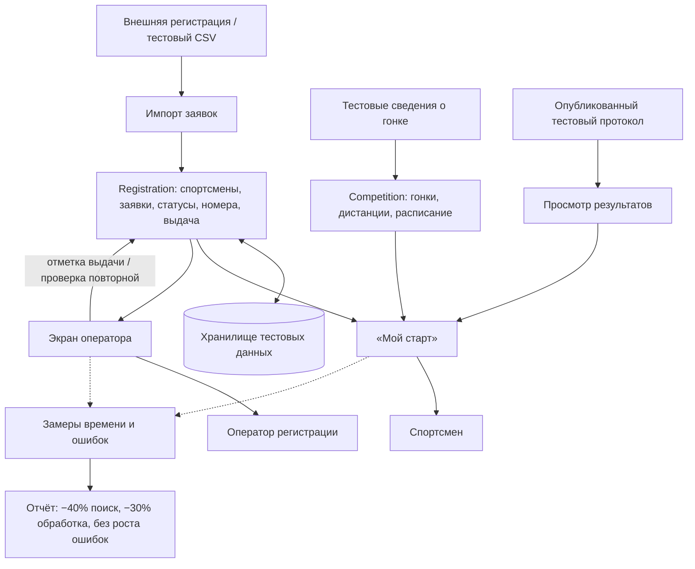

# КТ-4 · Шаг 6. Эскиз архитектуры семестрового прототипа

**Проект:** «Московские веломарафоны»  
**Статус:** эскиз планируемого прототипа, не утверждение о готовой реализации.  
**Контрольный срок:** 10.12.2026.  
**Выбранные гипотезы:** «Единый экран участника» и «Быстрая выдача пакетов».

## Компоненты и потоки данных

1. **Импорт тестовых данных.** Получает CSV/JSON с обезличенными заявками из формата внешней регистрации (например, REGPLACE); передаёт спортсменов и заявки в хранилище. Это не заявка на готовую живую интеграцию.
2. **Сведения о гонке (Competition).** Принимает подготовленные тестовые данные о дистанциях, времени и месте старта; предоставляет их странице спортсмена.
3. **Заявки и допуск (Registration).** Хранит спортивную идентичность, несколько отдельных заявок одного спортсмена, стартовые номера и статусы регистрации, оплаты, допуска и выдачи. Получает импортированные заявки и действия оператора; предоставляет данные двум интерфейсам. Статус оплаты только отображается — собственных платежей нет.
4. **Страница «Мой старт».** Читает сведения Competition/Registration и доступный тестовый результат; показывает спортсмену статус, дистанцию, время и место старта, номер и требования к документам. Самостоятельное оформление регистрации не входит в прототип.
5. **Экран оператора.** Читает из Registration спортсменов, их заявки и статусы; позволяет искать по фамилии/номеру, просматривать допуск и фиксировать выдачу. При повторной попытке выдачи предупреждает и не создаёт вторую запись.
6. **Просмотр результатов.** Получает тестовый опубликованный протокол, передаёт время и место спортсмена на «Мой старт». Полный модуль хронометража и судейские исправления не входят в прототип.
7. **Контур тестирования.** Получает результаты одинаковых пользовательских сценариев в старом процессе и прототипе; собирает время выполнения и ошибки для отчёта по критериям успеха.

## Схема

## Предполагаемый технологический стек

Для совместимости с основным проектом `technostd/velomarathon` рассматриваются **React + TypeScript, Inertia.js и Vite** для интерфейсов, **PHP + Laravel** для сервера, **PostgreSQL** для хранения, **Docker** для локальной среды. Для семестрового прототипа допустимы тестовые CSV/JSON и упрощённый источник данных. Итоговый стек будет обоснован в следующей фазе; реализация в `mvm-platform` пока не заявлена выполненной.

## Трассировка в рамках КТ-4

| Компонент | Функциональные требования | Задача верхнего уровня | Гипотеза |
|---|---|---|---|
| Competition + «Мой старт» | ФТ-1, ФТ-3 | Задача 2 — экран участника | Единый экран участника |
| Registration + «Мой старт» | ФТ-2 | Задача 2 — экран участника | Единый экран участника |
| Просмотр результатов + «Мой старт» | ФТ-4 | Задача 2 — экран участника | Единый экран участника |
| Registration + экран оператора | ФТ-5, ФТ-6 | Задача 3 — экран оператора | Быстрая выдача пакетов |
| Экран оператора + запись выдачи | ФТ-7, ФТ-8 | Задача 3 — экран оператора | Быстрая выдача пакетов |
| Макеты и контрольные сценарии | ФТ-1–ФТ-8 | Задача 1 — проектирование | Обе гипотезы |
| Контур тестирования | Проверка ФТ-1–ФТ-8 | Задача 4 — тестирование | Обе гипотезы |

## Границы и безопасность

- Работа только с тестовыми или обезличенными данными; реальные копии медсправок и паспортные сведения не загружаются.
- Полная проверка документов, разграничение реальных полномочий, платежи, собственная онлайн-регистрация, интеграции с хронометражем и история стартов — вне семестрового прототипа.
- В целевой системе права и доступ к медицинским данным потребуют серверного контроля; этот эскиз не заменяет техническое задание.

## Связанные материалы

- [Замысел полного решения](06_solution_concept.md) — более широкая модульная концепция и будущие этапы.
- [Актуальные технические требования основного проекта](https://github.com/technostd/velomarathon/blob/main/docs/README.md) — нормативный источник для будущей разработки.
