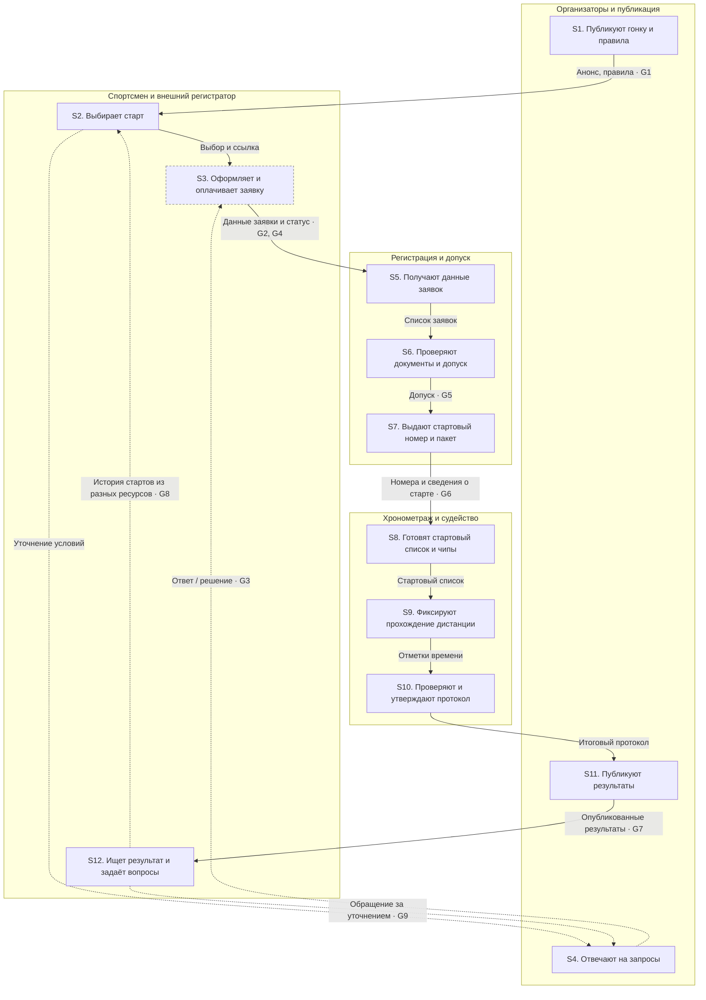

# Шаг 4. Схема деятельности и разрывы — Московские веломарафоны

**Версия:** 19.10.2026 · **Исследовательский контур:** `technostd/mvm-platform` · **Состояние:** реконструкция As-Is по имеющимся свидетельствам.

> Это схема **текущего пользовательского пути и предполагаемого операционного процесса**, а не протокол наблюдения всей последней гонки. Наблюдения о сайте и REGPLACE подтверждают внешние переходы; шаги внутренней обработки и вероятные ошибки требуют проверки с сотрудниками. Риски G3–G6 и G9 нельзя считать зафиксированными инцидентами. Никакие KPI или длительности не придуманы.  
> **Точность связей:** номера наблюдений ниже соответствуют [доске наблюдений](observations_board.md) и названиям в форме университета. Привязки к свидетельствам — в доске наблюдений.

## 1. Карта потока деятельности

Стрелка передаёт объект или сведения между ролями. **G1–G9** у стрелок обозначают разрывы, описанные далее. Пунктир — необязательный сценарий (обращение/повторный поиск).

### Таблица операций для переноса в форму

| № | Участник | Процесс или шаг | Объект или документ | Что и кому передаётся дальше |
|---|---|---|---|---|
| **Шаг 1** | Организаторы «Московских веломарафонов» | Публикуют анонс, календарь и правила гонки | Карточка гонки, положение, расписание, дистанции | Ссылка на гонку и условия участия — спортсменам |
| **Шаг 2** | Участник веломарафона | Изучает условия и выбирает дисциплину и дистанцию | Страница гонки, положение, категории, регистрационная ссылка | Выбранные условия и переход по ссылке — в REGPLACE |
| **Шаг 3** | Участник и система REGPLACE | Оформляют заявку и выполняют оплату участия | Профиль, регистрационная анкета, заявка, статус оплаты | Заявка и статус — в REGPLACE; подтверждение — участнику; сведения нужны службе регистрации |
| **Шаг 4** | Сотрудники поддержки организатора | Обрабатывают нестандартные обращения и уточнения | Письмо или сообщение по скидке, переносу, возврату | Ответ — участнику; необходимое изменение заявки — ответственному оператору |
| **Шаг 5** | Оператор регистрации | Получает и подготавливает сведения о заявленных спортсменах | Список заявок/выгрузка из внешней регистрации (точный формат не подтверждён) | Актуальный список спортсменов — службе допуска и выдачи |
| **Шаг 6** | Сотрудники проверки документов и медицинского допуска | Проверяют документы и определяют готовность к допуску | Заявка, сведения о спортсмене, документы, статус допуска | Решение о допуске — оператору регистрации и ответственным за старт |
| **Шаг 7** | Операторы регистрации и выдачи | Назначают номер и выдают стартовый пакет допущенному спортсмену | Стартовый номер, пакет участника, список выдачи | Номер и пакет — спортсмену; актуальные номера — хронометристам |
| **Шаг 8** | Операторы хронометража | Формируют стартовый список и сопоставляют номера с учётными записями хронометража | Список допущенных, стартовые номера, привязки чипов | Подготовленный стартовый список и привязки — системе хронометража |
| **Шаг 9** | Оборудование и операторы хронометража | Фиксируют старт, прохождение дистанции и финиш | Отметки времени, события контрольных точек, идентификаторы номеров/чипов | Измерения и события — в обработку хронометража и судьям |
| **Шаг 10** | Судьи и операторы хронометража | Проверяют результаты и утверждают итоговый протокол | Отметки времени, спорные записи, предварительный и итоговый протокол | Проверенный протокол — ответственному за публикацию результатов |
| **Шаг 11** | Администратор сайта результатов | Публикует протокол и сведения о финише | Итоговый протокол, результаты по категориям, ссылка на портал | Ссылка и опубликованные результаты — спортсменам и зрителям |
| **Шаг 12** | Участник и сотрудники поддержки | Ищут историю стартов и уточняют спорные сведения | Публичные протоколы, архивные страницы, письмо/обращение | Уточнение — организатору или ответственному за результаты; итог — участнику |

### Границы подтверждения внутренних шагов

- **Подтверждено публичным маршрутом:** S1–S3, отдельный канал обращений S4, отдельное размещение результатов S11–S12.
- **Частично описано в требованиях, фактические операции последней гонки ещё не проверены:** S5–S10 (точный формат выгрузки, кто изменяет данные, регламент допуска, подготовка номера и чипа, протокол судейских исправлений).
- **Примечание:** привязка конкретной марки оборудования к последней гонке не подтверждена — на схеме указана только роль оборудования/хронометража.

## 2. Карта разрывов, привязанных к шагам

| ID | Шаг | Тип в вузовской форме | Статус подтверждения | Наблюдения |
|---|---|---|---|---|
| **G1** | Шаг 1 | Отсутствие информации | Подтверждён структурный разрыв | № 1, № 12 |
| **G2** | Шаг 3 | Отсутствие информации | Подтверждён структурный разрыв | № 1, № 2, № 17 |
| **G3** | Шаг 4 | Задержка | Риск, задержка не измерена | № 4, № 8 |
| **G4** | Шаг 5 | Дублирование | Гипотеза, ручные операции не измерены | № 9, № 13 |
| **G5** | Шаг 6 | Задержка | Гипотеза, время проверки не измерено | № 10, № 15, № 19 |
| **G6** | Шаг 8 | Ошибка | Гипотеза, случаи не подтверждены | № 9, № 18 |
| **G7** | Шаг 11 | Отсутствие информации | Подтверждён структурный разрыв | № 1, № 12, № 17 |
| **G8** | Шаг 12 | Отсутствие информации | Подтверждена распределённость архивов; неудобство — гипотеза | № 1, № 11, № 12 |
| **G9** | Шаг 12 | Задержка | Гипотеза, сроки не измерены | № 4, № 19 |

### G1. Отсутствие информации на шаге 1

- **На каком шаге возникает:** Шаг 1.
- **Тип разрыва:** Отсутствие информации.
- **Что идёт не так:** Анонс, подробные правила, регистрация и результаты находятся в разных ресурсах. На одной странице участник не видит весь путь от выбора гонки до результата и вынужден переходить по внешним ссылкам.
- **Наблюдения, которые это подтверждают:** **№ 1** — «Информацию о соревновании, регистрацию и результаты я обнаружил на разных ресурсах…»; **№ 12** — «Я зафиксировал разрыв между нынешним распределением пользовательского пути по нескольким сервисам и документированным направлением развития…».
- **Статус:** Подтверждён структурный разрыв.
- **Как проверить:** Проверить, какие именно сведения спортсмены не находят и сколько переходов совершают.

### G2. Отсутствие информации на шаге 3

- **На каком шаге возникает:** Шаг 3.
- **Тип разрыва:** Отсутствие информации.
- **Что идёт не так:** Состояние заявки и оплаты доступно в кабинете внешнего регистратора, но не связано с единой страницей участника у организатора. Спортсмен проверяет сведения о своём участии в отдельном сервисе.
- **Наблюдения, которые это подтверждают:** **№ 1** — «Информацию о соревновании, регистрацию и результаты я обнаружил на разных ресурсах…»; **№ 2** — «Я установил, что регистрация на Томилинский веломарафон 2026 года была организована через внешнюю платформу REGPLACE…»; **№ 17** — «Участнику может быть нужен единый понятный способ узнать статус регистрации, требования допуска и итоговый результат…».
- **Статус:** Подтверждён структурный разрыв.
- **Как проверить:** Проверить фактические статусы и их доступность для организатора.

### G3. Задержка на шаге 4

- **На каком шаге возникает:** Шаг 4.
- **Тип разрыва:** Задержка.
- **Что идёт не так:** Для отдельных скидок участнику нужно отдельно написать организатору вместо завершения всего сценария в форме регистрации. Возникает дополнительный этап согласования, который потенциально задерживает оформление; время ответа неизвестно.
- **Наблюдения, которые это подтверждают:** **№ 4** — «В описании регистрации отмечен отдельный способ обращения к организатору по электронной почте по вопросам некоторых скидок…»; **№ 8** — «Предполагаю, что необходимость переходить между сайтом, регистрацией и результатами может затруднять участнику поиск актуальной информации…».
- **Статус:** Риск, задержка не измерена.
- **Как проверить:** Установить количество таких обращений и время их обработки.

### G4. Дублирование на шаге 5

- **На каком шаге возникает:** Шаг 5.
- **Тип разрыва:** Дублирование.
- **Что идёт не так:** При переносе заявок из REGPLACE в рабочие списки регистрации и хронометража может потребоваться повторная сверка и внесение исправлений. Наличие автоматического сквозного обмена и его надёжность пока не подтверждены.
- **Наблюдения, которые это подтверждают:** **№ 9** — «Предполагаю, что при обмене данными между REGPLACE и хронометражем могут возникать ручные сверки, расхождения или повторный ввод сведений…»; **№ 13** — «Заявлена цель развивать собственную регистрацию, но в переходном этапе предполагается сохранять импорт из внешнего сервиса…».
- **Статус:** Гипотеза, ручные операции не измерены.
- **Как проверить:** Получить две обезличенные выгрузки и проследить один процесс передачи.

### G5. Задержка на шаге 6

- **На каком шаге возникает:** Шаг 6.
- **Тип разрыва:** Задержка.
- **Что идёт не так:** Если ранее проверенные сведения и действующие медицинские документы предъявляются и проверяются повторно, очередь на допуск и выдачу может увеличиться. Реальная процедура повторного допуска требует проверки.
- **Наблюдения, которые это подтверждают:** **№ 10** — «Предполагаю, что повторная проверка ранее подтверждённых сведений и медицинских документов может замедлять выдачу стартовых пакетов…»; **№ 15** — «Для работы на старте оператору необходимы быстрый поиск спортсмена, проверка статуса допуска и доступ к сведениям о выдаче…»; **№ 19** — «Сколько времени фактически занимают сверка заявок, проверка документов, выдача пакета и подготовка окончательного протокола…».
- **Статус:** Гипотеза, время проверки не измерено.
- **Как проверить:** Понаблюдать за 20 последовательными выдачами с фиксацией времени.

### G6. Ошибка на шаге 8

- **На каком шаге возникает:** Шаг 8.
- **Тип разрыва:** Ошибка.
- **Что идёт не так:** При изменении заявки, стартового номера или привязки чипа после подготовки списка возможна несогласованность данных регистрации и хронометража. В таком случае потребуется разбор и исправление результата; подтверждённых инцидентов нет.
- **Наблюдения, которые это подтверждают:** **№ 9** — «Предполагаю, что при обмене данными между REGPLACE и хронометражем могут возникать ручные сверки, расхождения или повторный ввод сведений…»; **№ 18** — «Какие конкретные ошибки с заявками, медицинским допуском, стартовыми номерами или результатами происходили на последних гонках…».
- **Статус:** Гипотеза, случаи не подтверждены.
- **Как проверить:** Запросить пример изменения заявки/номера и сравнить версии стартовых списков.

### G7. Отсутствие информации на шаге 11

- **На каком шаге возникает:** Шаг 11.
- **Тип разрыва:** Отсутствие информации.
- **Что идёт не так:** Итоговый протокол публикуется отдельно от оформления заявки. На одном пользовательском экране не установлена сквозная связь между регистрацией, стартом и опубликованным результатом.
- **Наблюдения, которые это подтверждают:** **№ 1** — «Информацию о соревновании, регистрацию и результаты я обнаружил на разных ресурсах…»; **№ 12** — «Я зафиксировал разрыв между нынешним распределением пользовательского пути по нескольким сервисам и документированным направлением развития…»; **№ 17** — «Участнику может быть нужен единый понятный способ узнать статус регистрации, требования допуска и итоговый результат…».
- **Статус:** Подтверждён структурный разрыв.
- **Как проверить:** Проверить, как участник ищет именно свой результат.

### G8. Отсутствие информации на шаге 12

- **На каком шаге возникает:** Шаг 12.
- **Тип разрыва:** Отсутствие информации.
- **Что идёт не так:** Результаты разных лет описаны в нескольких архивных системах. Единой подтверждённой точки просмотра истории всех стартов нет; спортсмену может понадобиться поиск в разных местах.
- **Наблюдения, которые это подтверждают:** **№ 1** — «Информацию о соревновании, регистрацию и результаты я обнаружил на разных ресурсах…»; **№ 11** — «Предполагаю, что единая история гонок и результатов может быть полезна спортсменам, регулярно участвующим в серии…»; **№ 12** — «Я зафиксировал разрыв между нынешним распределением пользовательского пути по нескольким сервисам и документированным направлением развития…».
- **Статус:** Подтверждена распределённость архивов; неудобство — гипотеза.
- **Как проверить:** Проверить на 3–5 реальных стартах одного спортсмена из разных сезонов.

### G9. Задержка на шаге 12

- **На каком шаге возникает:** Шаг 12.
- **Тип разрыва:** Задержка.
- **Что идёт не так:** Вопросы по заявкам, возвратам или результатам могут уходить в отдельную переписку с организатором. Пока нет подтверждённого процесса отслеживания таких запросов и времени их закрытия.
- **Наблюдения, которые это подтверждают:** **№ 4** — «В описании регистрации отмечен отдельный способ обращения к организатору по электронной почте по вопросам некоторых скидок…»; **№ 19** — «Сколько времени фактически занимают сверка заявок, проверка документов, выдача пакета и подготовка окончательного протокола…».
- **Статус:** Гипотеза, сроки не измерены.
- **Как проверить:** Получить обезличенную выборку обращений и измерить время ответа.

## 3. Приоритетные точки исследования (не результаты измерений)

1. **G4, G6 — передача данных REGPLACE → регистрация → тайминг.** Сопоставить одну обезличенную заявку, её изменения, номер, чип и результат. Это даст ответ о наличии/отсутствии расхождений.
2. **G5 — выдача и допуск.** Замерить реальные действия, повторные документы и очереди вместо предположения об экономии времени.
3. **G1, G2, G7, G8 — путь спортсмена.** Провести тест поиска статуса и результата со спортсменами; разделить фактическое число переходов и субъективное неудобство.
4. **G3, G9 — переписка и нестандартные обращения.** По обезличенным данным проверить случаи и сроки ответа, не утверждая их заранее.

## 4. Внутренние источники

- [Журнал свидетельств](evidence_journal.md)
- [Доска наблюдений](observations_board.md)
- [Исследование текущего процесса As-Is](process_as_is.md)
- [Резюме обсуждения требований с заказчиком — проект на согласование](customer_meeting_summary.md)
- [Таблица предположений](assumptions_table.md)
- [План полевых проверок](03_research.md)

**Важно:** резюме требований [не является стенограммой отдельного интервью](customer_meeting_summary.md). При появлении подтверждённого протокола и реальных измерений карту следует обновить.
